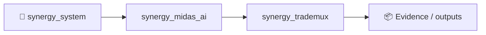

# SYNERGY TradeMux

> **Venue-neutral execution fabric with smart routing, split execution and reconciliation evidence**

Version: `2.0.0`

**Enterprise v2.0.0** · Python 3.11+ · FastAPI/OpenAPI · Docker/Compose · RBAC/JWT · PostgreSQL/ClickHouse audit

**Designed for:** Brokers, crypto venues, prop firms, market makers and multi-venue trading teams  
**Primary planning endpoint:** `POST /enterprise/v1/execution/plan`  
**Live dispatch:** `POST /enterprise/v1/execution/dispatch` — operator-only and environment-gated

> [!IMPORTANT]
> Execution infrastructure only. No promise of fills, cost improvement or profit. Live capital requires customer venue certification and Trading/Risk/Ops/Security approval.

## Institutional package
- smart routing and split-execution core;
- tenant RBAC, request-ID audit and metrics;
- Bybit V5, CCXT and MetaTrader 5 integration contracts;
- live execution disabled by default;
- Docker/Compose, tests, load harnesses and customer-pilot docs.

## Verification
**20 tests passed** · health smoke **80/80 200** · local health p95 **103.4 ms** (~452 req/s). Smoke only, not an execution benchmark.

## Quick start
```bash
pip install -e '.[dev,enterprise]'
pytest -q
python -m synergy_trademux.api
```
Open `/docs`.

## CTO package
[Due diligence](docs/CTO_DUE_DILIGENCE.md) · [Architecture](docs/ARCHITECTURE_DIAGRAMS.md) · [API](docs/API_EXAMPLES.md) · [Security](SECURITY.md) · [Benchmarks](docs/BENCHMARKS_AND_ACCEPTANCE.md) · [SLA/SLO](docs/SLA_SLO.md) · [Deployment](docs/DEPLOYMENT_CHECKLIST.md) · [Pilot](docs/CUSTOMER_PILOT.md)


<!-- SYNERGY-FEDERATION-PASSPORT:START -->
---

## 🧭 SYNERGY federation passport

**Домен:** 🔀 Trade routing / mux  
**Архитектурный родитель:** [`synergy_midas_ai`](https://github.com/Shtenco/synergy_midas_ai)  
**Архитектурный корень:** [`synergy_system`](https://github.com/Shtenco/synergy_system)



Архитектурная стрелка — это карта федерации, а не автоматически подтверждённая runtime dependency.

### Единый стандарт

Каждый проект должен документировать реальную проблему, реализацию, тесты, evidence, ограничения, file map, воспроизводимость, roadmap и границы утверждений. Это тот же принцип, который используется в `dlp_solver`.

### Навигация

- [📚 Атлас всех 75 репозиториев](https://github.com/Shtenco/synergy_system/blob/main/docs/SYNERGY_REPOSITORY_ATLAS.md)
- [🧾 Машиночитаемый registry](https://github.com/Shtenco/synergy_system/blob/main/registry/SYNERGY_REPOSITORIES.json)
- [🧭 SYNERGY SYSTEM](https://github.com/Shtenco/synergy_system)

### Evidence rule

`GREEN` означает только воспроизводимо подтверждённый тезис. Гипотеза, benchmark без корректного протокола, архитектурная диаграмма или красивый экономический цикл сами по себе GREEN не дают.

<!-- SYNERGY-FEDERATION-PASSPORT:END -->