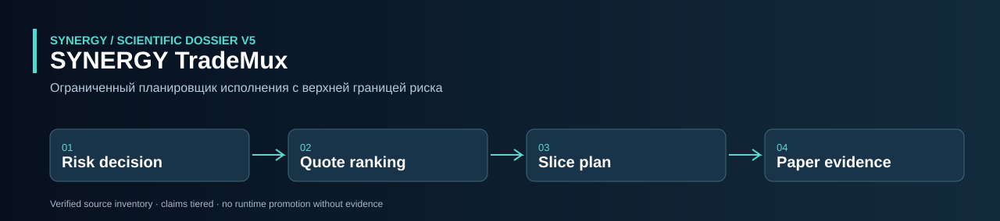
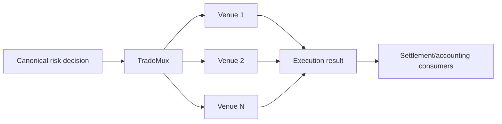

<!-- SCIENTIFIC-V5-2026:START -->


**[Научно-техническое досье V5: математика, исходники, тесты, ограничения](docs/SCIENTIFIC_DOSSIER_V5_2026.md)**  
**Проверяемый статус:** CANDIDATE: код роутинга, paper fills и тесты; реальные fills не доказаны. Предыдущий README ниже сохранён; наличие кода не означает подтверждённого production.

<!-- SCIENTIFIC-V5-2026:END -->

#  SYNERGY TradeMux — verified technical dossier

> **Статус:**  CANDIDATE execution-planning layer.
> **Проверено по фактическому `main`:** 29.09.2026.
> **Authority:** trade execution boundary, но real broker fills не выводятся из paper adapter.

## 1.  Задача

TradeMux получает canonical risk decision и строит bounded multi-venue execution plan по costs, latency и available notional.

Главная цепочка:

```text
risk decision
→ approved notional
→ venue ranking
→ slices
→ adapters
→ fills
→ execution result evidence
```

## 2.  Фактический состав

Repository содержит:

- `core.py`;
- `api.py`;
- `synergy_contracts.py`;
- enterprise auth/audit package;
- tests;
- Docker/deploy/loadtests/docs/examples.

## 3.  VenueQuote

Fields:

```text
venue
price
available_notional
fee_bps
slippage_bps
latency_ms
risk_score
```

All-in cost:

[
C_{bps}=
fee_{bps}+slippage_{bps}+100cdot riskScore
]

## 4.  Smart routing

`smart_route(notional,quotes,max_venues=4)`:

1. reject notional <=0;
2. sort quotes by:
   - all-in bps ascending;
   - latency ascending;
3. keep first max venues;
4. allocate min(remaining, available_notional);
5. return slices + unfilled notional.

Это deterministic greedy router, не global optimizer.

## 5.  ExecutionPlan

Plan содержит:

- random correlation id;
- tuple slices;
- unfilled notional.

Slice содержит venue/notional/expected price/expected cost bps.

## 6.  PaperAdapter

`PaperAdapter` возвращает full synthetic fill:

- requested = filled;
- fixed configured price;
- fee based on bps;
- generated paper external id.

Это test/paper adapter. Он **не доказывает broker connectivity**.

## 7.  Risk gate

```text
UPSTREAM_CONTRACT_ID = synergy.trading.risk-decision/v1
PLAN_CONTRACT_ID     = synergy.trading.execution-plan/v1
RESULT_CONTRACT_ID   = synergy.trading.execution-result/v1
AUTHORITY            = trade_execution
```

`plan_from_risk_decision`:

- REJECT/KILL_SWITCH → exception;
- unknown action → exception;
- only ALLOW/RESIZE accepted;
- approved_notional must be >0;
- route строится только для approved amount.

Это критический authority boundary: TradeMux не должен увеличивать risk-approved notional.

## 8.  Inputs

- canonical risk payload;
- venue quotes;
- symbol;
- side;
- max venues.

## 9.  Outputs

### Plan payload

- risk event id;
- correlation id;
- symbol/side;
- requested notional;
- slices;
- unfilled notional.

### Result payload

- plan event id;
- requested/filled notional;
- fills;
- status;
- external ids.

## 10.  Invariants

```text
REJECT/KILL_SWITCH -> no plan
approved_notional <=0 -> no plan
planned total <= approved notional
available venue capacity bounds each slice
paper fill != real fill
execution plan != execution result
result != accounting recognition
```

## 11.  Current routing limitations

Greedy cost ranking currently не учитывает в core:

- price direction/side when comparing absolute prices;
- nonlinear impact;
- venue minimum order size;
- partial-fill probabilities;
- cancel/retry;
- timeout;
- venue correlation;
- smart order timing;
- dynamic quote decay.

`latency_ms` используется только secondary sort key.

## 12.  Required execution tests

- slice conservation;
- unfilled notional;
- max venues;
- risk reject;
- resize cap;
- zero/negative requested;
- venue capacity zero;
- quote stale;
- partial fill;
- duplicate external id;
- retry idempotency;
- crash recovery;
- side-aware price quality;
- fees vs actual fill reconciliation.

## 13.  Exactly-once / idempotency requirement

Production executor должен связывать:

```text
risk_event_id
plan_event_id
correlation_id
external_order_id
fill_id
```

и не повторять order после uncertain timeout без reconcile.

Current core генерирует correlation UUID, но полноценная persistent idempotency state machine требует отдельного evidence.

## 14.  Воспроизводимость

```bash
git clone https://github.com/Shtenco/synergy_trademux.git
cd synergy_trademux
python -m pip install -e .
pytest -q
```

## 15.  Карта repository

| Path | Role |
|---|---|
| `src/.../core.py` | quotes/router/paper adapter |
| `src/.../synergy_contracts.py` | risk→plan→result contracts |
| `src/.../api.py` | API |
| enterprise | auth/audit |
| tests | execution/product/deploy tests |
| Docker/deploy/loadtests | ops scaffold |

## 16.  Место в SYNERGY



## 17.  Evidence maturity

| Layer | Status |
|---|---|
| risk-gated planning |  |
| multi-venue slices |  |
| plan/result payloads |  |
| paper adapter |  |
| real broker adapters | not proven by inspected core |
| persistent idempotency | incomplete |
| observed real fills |  |
| cross-repo E2E |  |

## 18.  Roadmap

1. real adapter evidence;
2. persistent idempotency/reconcile;
3. quote timestamps;
4. side-aware executable cost;
5. partial-fill state machine;
6. cancel/replace;
7. execution TCA;
8. settlement/accounting linkage;
9. observed federation run.

## 19.  Что проект НЕ утверждает

- that PaperAdapter equals broker integration;
- that cheapest modeled venue yields best actual execution;
- that execution plan is a fill;
- that risk-approved means profitable;
- that source presence proves live deployment.

## 20.  Routing properties

A production router should prove conservation properties for every plan.

### Notional conservation

[
sum_i slice_i + unfilled = approvedNotional
]

within numeric tolerance.

### Capacity bound

For each venue:

[
slice_i le availableNotional_i
]

### Venue-count bound

[
count(slices)le maxVenues
]

### Risk bound

Requested execution can never exceed canonical `approved_notional`, even if the caller passes a larger `requested_notional` into a later serializer.

These should be property tests, not assumptions.

## 21.  Price-side semantics

Current `smart_route` ranks by modeled bps cost and latency but does not use BUY/SELL side or price improvement when ranking quotes.

For real execution, effective economics differ:

- BUY prefers lower executable price;
- SELL prefers higher executable price;
- fees/slippage are then combined with price.

A future all-in comparator must be side-aware and unit-consistent.

## 22.  Uncertain execution state machine

The dangerous case is:

```text
send order
→ network timeout
→ unknown whether venue accepted
```

Blind retry can duplicate exposure.

Required states should include:

```text
PLANNED
SUBMITTING
ACKNOWLEDGED
PARTIALLY_FILLED
FILLED
CANCEL_PENDING
CANCELLED
UNKNOWN_RECONCILE
FAILED
```

and persistent idempotency keys.

## 23.  Execution evidence

Each external fill should preserve:

- venue/order id;
- client idempotency id;
- timestamps;
- requested/filled qty;
- price;
- fees;
- quote snapshot/hash;
- risk event id;
- plan id;
- reconciliation state.

Only after external receipt reconciliation may settlement/accounting consume the result.

## 24.  Transaction-cost analysis

For each plan compare:

[
ImplementationShortfall
=
ActualFillValue
-
DecisionBenchmarkValue
]

plus fees, latency and opportunity cost. This is necessary to determine whether modeled routing ranking actually improves execution.

## 25.  Promotion gate

Real E2E status requires at least one non-paper adapter observed under replay/idempotency tests, exact risk→plan→fill evidence, and downstream settlement reconciliation. PaperAdapter alone is intentionally insufficient.

---

[ SYNERGY SYSTEM](https://github.com/Shtenco/synergy_system) · [ Atlas](https://github.com/Shtenco/synergy_system/blob/main/docs/SYNERGY_REPOSITORY_ATLAS.md)
