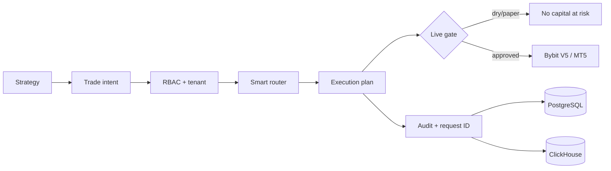

# Architecture — SYNERGY TradeMux

Planning endpoint: `/enterprise/v1/execution/plan`. Explicit live dispatch: `POST /enterprise/v1/execution/dispatch` and requires operator role plus environment gate.