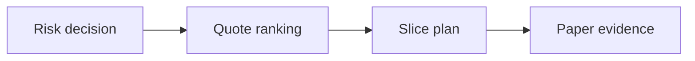

# SYNERGY TradeMux — научно-техническое досье V5

**Ревизия:** 24.10.2026 · **Партия:** репозитории SYNERGY №68–82 · **Фактический статус:** CANDIDATE: код роутинга, paper fills и тесты; реальные fills не доказаны.

> Исходники и наличие тестов проверены по дереву `main`. Это **документационный аудит**, не свидетельство свежего CI, успешного деплоя, воспроизводимого benchmark или экономической прибыли. Старый README сохранён.

## 1. Научная постановка

Преобразовывать уже одобренный RiskGuard объём сделки в ограниченный набор venue slices, учитывая стоимость, задержку и доступную ликвидность.

## 2. Реализация и исследовательская новизна

`smart_route` ранжирует котировки по сумме fee/slippage/risk и затем по latency; выбирает до `max_venues` и последовательно распределяет notional. Возвращает план, корреляционный идентификатор и остаток. `PaperAdapter` исполняет только синтетическое полное заполнение.

## 3. Математическая формализация

\[c_i^{\mathrm{bps}}=f_i+s_i+100\rho_i,\qquad a_i=\min\!\left(\max(N-\sum_{j<i}a_j,0),\max(L_i,0)\right).\]
\[\mathrm{unfilled}=\max(N-\sum_i a_i,0),\quad\sum_i a_i\leq N.\]

Разграничение: формула, реализованная в исходном коде, может быть перепроверена статически; численные результаты и перенос на реальные данные требуют отдельного исполнения с артефактами и независимыми baseline.

## 4. Операционная цепочка



`architecture` описывает поток данных и проектное назначение; автоматически подтверждённой federated runtime-связи отсюда не следует.

## 5. Навигация по проверенным артефактам

- [`src/synergy_trademux/core.py`](../src/synergy_trademux/core.py)
- [`src/synergy_trademux/synergy_contracts.py`](../src/synergy_trademux/synergy_contracts.py)
- [`tests/test_core.py`](../tests/test_core.py)
- [`tests/test_synergy_contracts.py`](../tests/test_synergy_contracts.py)

## 6. Воспроизведение: доступная команда

```bash
python -m pip install -e .
python -m pytest -q
```

Команды приведены как **инструкция для самостоятельного запуска**, они не означают, что тесты были выполнены в рамках данной документационной ревизии.

## 7. Проверяемые гипотезы и acceptance gates

Инвариант `sum(slices)+unfilled≈approved_notional`, REJECT/KILL_SWITCH, нулевая ёмкость, отрицательные котировки, дубли venue, тай-ауты и частичные fills.

**Граница доказательности:** `SOURCE_PRESENT` и `TEST_SOURCE_PRESENT` отличаются от `TEST_EXECUTED`, `INTEGRATION_VERIFIED`, `DEPLOYED` и `PRODUCTION_READY`. Для повышения статуса нужны command, environment, commit SHA, input manifest, raw output и критерий проверки.

## 8. Угрозы и отказоустойчивость

Нарушение границы RiskGuard, overfill, повторное исполнение при retry, недостоверная оценка проскальзывания, stale quote и расхождение reported/canonical fill.

## 9. Не доказано / ограничения

Greedy ordering не гарантирует глобального оптимума; бумажный fill не подтверждает фактическую глубину рынка, исполнение ордера, FIFO или биржевую авторизацию.

## 10. Следующий инженерный рубеж

Ввести signed risk decision, idempotency key, TTL котировки, полноценную модель partial fill и replay-тесты перед реальными брокерскими интеграциями.

## 11. Стандарт оформления и история

Досье ориентируется на практику [REVERSE-EXP](https://github.com/Shtenco/dlp_solver) и [SYNERGY SYSTEM](https://github.com/Shtenco/synergy_system): проверяемая постановка, формулы, ссылки на настоящий код, fidelity к реальному зрелости проекта и явные фальсифицирующие тесты. Исходный README и Git-история не удаляются. Четыре охраняемых README экосистемы остаются вне этой партии.
